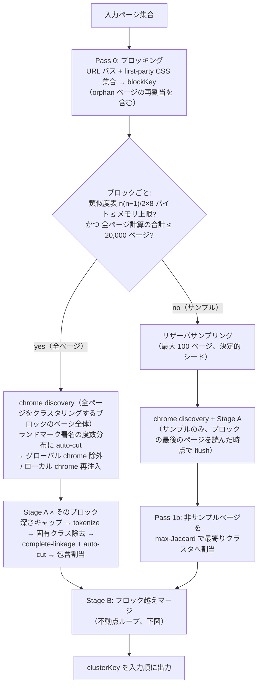
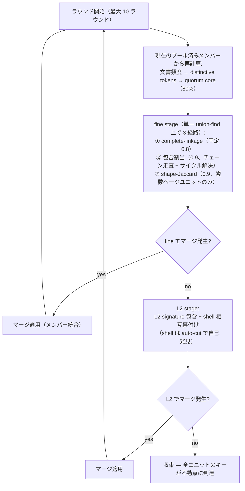

# @nitpicker/archive

`.nitpicker` アーカイブ（tar + SQLite）の読み書きを担う内部パッケージです。スキーマ定義・マイグレーション・`Archive` / `ArchiveAccessor`・tar 展開キャッシュ・concat / split・body hash・URL alias・技術スタック検出のロールアップ・テンプレート分類・スコープ判定・エラー分類を含みます。

ヘッドレスブラウザ（puppeteer / `@d-zero/beholder`）や `@d-zero/dealer` には依存しないため、読み取り専用の経路（[@nitpicker/query](../query/README.md)、viewer、mcp-server、report-\*）はクローラーを引き込まずにアーカイブを扱えます。クロール時の書き込みは [@nitpicker/crawler](../crawler/README.md) がこのパッケージ経由で行います。

## 使い方

公開 API は機能単位のサブパスで export しています（パッケージルート `.` の export はありません）。

```ts
import Archive from '@nitpicker/archive/archive';
import { classifyErrorKind } from '@nitpicker/archive/error-kind/classify-error-kind';

// `await using` が SQLite ハンドルを確実に閉じる
await using accessor = await Archive.openCached('/path/to/site.nitpicker');
const config = await accessor.getConfig();

console.log(classifyErrorKind('net::ERR_NAME_NOT_RESOLVED')); // 'dns'
```

利用可能なサブパスは `package.json` の `exports` を参照してください。

## テンプレート分類（page-cluster）

テンプレート分類（`src/template-classification/`）は、ページを DOM 構造の類似性でクラスタリングします。計算はすべて [@nitpicker/core](../core/README.md) のネイティブアドオン（Rust の `nitpicker_template_cluster`）が実行し、`src/template-classification/page-cluster/` にはそれを駆動するドライバ（`resolve-page-cluster-keys.ts` の `resolvePageClusterKeys`）だけがあります。ドライバはページのシグナル（URL パス・スタイルシート・ホスト）を渡してから、各ページの HTML を必要な読み込みでだけ取り出して渡し、ページごとのキーとクラスタごとの reason を受け取ります。ドライバはこのディレクトリの外（`@nitpicker/core` を除く）に依存せず、パッケージの `exports` にも載せていません。呼び出しは `classify-page-templates.ts` / `create-page-cluster-factory.ts` に閉じています（ほかはテスト専用の `golden/`）。分類器の `clusterKey` は nitpicker 側で `templateKey` と呼び替えます。

出力は既存アーカイブに保存済みの `templateKey` と reason にバイト単位で一致し、`src/template-classification/golden/` の golden がそれを固定しています。

### アルゴリズム概観

`clusterKey` がどう決まるかを知っておくと、分類結果の解釈（なぜこの 2 ページが同じ `templateKey` なのか）がしやすくなります。実装詳細の WHY は `nitpicker_template_cluster` の各モジュールの doc comment が正です。

#### 全体パイプライン



- **Pass 0（ブロッキング）** — HTML を読まず、URL パスと first-party stylesheet 集合だけで粗く分割します。高価な構造比較を同一ブロック内に閉じ込め、コーパス全体の比較コストを O(n²) から劇的に減らします。stylesheet を持たない orphan ページは同一セクションの CSS ブロックへ再割当されます
- **chrome discovery** — 全ページのランドマーク署名の度数分布に auto-cut を当て、閾値以上を「グローバル chrome」（サイト共通のヘッダー等）として比較から除外し、閾値未満かつ 2 ページ以上に出現するものを「ローカル chrome」（セクション固有のナビ等）としてトークン再注入します
- **Stage A（ブロック内クラスタリング）** — ブロックごとに直線的に処理します。本文ルート（`contentRoot` → `<main>` → 内蔵リスト）の深さキャップ（候補深度 2〜10 を全走査して knee を探す自動選択）→ tokenize → **ページ固有クラスの除去**（ブロック内で 1 ページにしか現れないクラスは `<article class="outline">` のようなページ識別ラベルであってテンプレート構造ではないので、`allowedClasses` で除いて再 tokenize します。10 ページ以上のブロックのみ）→ complete-linkage 階層クラスタリング → max-gap auto-cut でカット高を決定 → 最後に包含関係にあるクラスタを吸収する包含割当（割当チェーンを辿り、循環はメンバー最大のクラスタをルートに選んで解決）
- **Pass 1b（サンプルに落としたブロックのみ）** — Stage A の類似度表がメモリ上限（`--template-memory-budget <MiB>` または `NITPICKER_TEMPLATE_MEMORY_BUDGET`、既定 512 MiB、0 なら全ブロック）を超えるブロックだけ、リザーバサンプリング（最大 100 ページ、ブロックキーをシードにした決定的乱数）で代表させ、サンプル外のページは Stage A 完了後に max-Jaccard で最寄りクラスタへ一括割当する（tokenize にはサンプルで学習した許可クラス集合を適用し、サンプル側と同じ規則で比較します）。そのブロックのメモリ使用量はブロックのページ数ではなくサンプルサイズに比例します。もう 1 つの上限は、全ページで計算するブロックのページ（HTML の解析結果を計算が終わるまで全ブロック分抱える。1 ページ約 60KB）の合計で、`@nitpicker/core` の `TEMPLATE_EXACT_PAGE_LIMIT`（20,000 ページ、固定）です。超えるときは、標本より大きい（100 ページを超える）ブロックを、ページ数が多い順（同数ならブロックの出現順）に、収まるまでサンプルに落とします。100 ページ以下のブロックはサンプルにしても保持ページが減らないので落とさず、それだけで上限を超えるときは超えたまま保持します。ブロックの判定はページ数だけで決まり（重複する集合のまとめ込みはしません）、判定したブロックは `block-sampled` の進捗イベントと分類結果の `sampledBlocks` に、理由（`table-over-budget`、`pages-over-limit`）つきで残ります。サンプルに落としたブロックを含むマージ済みグループは Stage B でも 100 メンバーに抑えます
- **Stage B（ブロック越えマージ）** — ブロック分割はあくまで比較コスト削減のためなので、最後に同一テンプレートがブロックを跨いで分かれていないか再統合します。これが唯一の反復処理です（次節）。収束後、確定した最終クラスタごとに reason（`TemplateClusterReason`）を 1 つずつ組み立てます — 追加の全コーパススキャンではなく、Stage A/B が既に計算済みの中間データ（quorum core、landmark インスタンス、ブロッキング根拠）を再利用するだけなので、クラスタ数にしか比例しません

#### Stage B: ブロック越え統合の不動点ループ



マージが起きるとユニットのメンバー構成が変わり、文書頻度も quorum core も変わります。そのため毎ラウンド、統合後のプールから全指標を**再計算**してマージを再試行します。fine stage・L2 stage の両方でマージが 1 件も出なくなった時点で不動点に到達したとみなして収束します（安全弁として最大 10 ラウンド。実データでは 7 ラウンド以内に収束）。L2 stage は fine stage が空振りしたラウンドでしか実行されない最後の粗い経路で、誤マージ防止のために shell（ランドマーク由来トークン）の相互裏付けを要求します。

fine stage・L2 stage いずれの経路で提案されたマージも、適用前に**凝集度ガード**を通ります: 統合後の quorum core が統合前の core に対して一定比率を下回るなら、そのマージは破棄されます。個々の経路が「統合前のペア類似度」だけを見て提案する一方、複数ラウンドにわたる連鎖的な統合は「統合後に実際どれだけまとまっているか」を悪化させ得る（無関係なテンプレート同士が少しずつ吸収し合う catch-all 化）ため、経路をまたいだ単一のチェックポイントとして機能します。あわせて、L2 stage 自体もラウンド開始前に判別力を検査し、参加ユニット全体が同一の署名形状に潰れている（`main` 直下の浅い階層しか手がかりが残っていない等）場合は、そのラウンドの L2 比較を丸ごとスキップします。詳細は `merge_cross_block_clusters.rs` / `filter_merges_by_cohesion.rs` / `l2_signature.rs` の doc comment を参照してください。

凝集度ガードの前に、Stage A が同一ブロック内で別クラスタと判定した（双方 3 ページ以上の）ユニット同士を、構造トークンに実質的な差がある限り統合しない**分離尊重ガード**も通ります。生の core では閾値に届かないが、クラス名を除くと骨格が一致する組（BEM 名だけが違う同一骨格）は対象外です。詳細は `filter_merges_by_stage_a_separation.rs` の doc comment を参照してください。

#### Self-tuning

閾値の多くは **max-gap auto-cut**（度数分布の隣接ギャップ最大の中点を境界とする）でデータから自己発見されます。① Stage A のカット高、② Stage B の shell 判定、③ chrome discovery のグローバル/ローカル判定、の 3 箇所で同一プリミティブを再利用しているので、サイトごとにハイパーパラメータをチューニングする必要はありません。詳細は `auto_cut_threshold.rs` の doc comment を参照してください。例外的に Stage B fine stage の complete-linkage だけは固定閾値 0.8 を使います（理由は `merge_cross_block_clusters.rs` を参照）。

### golden（出力を固定するテスト）

`src/template-classification/golden/` は、分類器の出力（ページごとの `templateKey` と、`page_template_clusters` に保存される reason JSON の文字列）を `__golden__/` に固定し、全件一致を確かめます。入力は、決定的に生成する合成サイトと `page-cluster/__fixtures__/` の HTML で、ドライバに直接渡します。合成サイトは、小さい 1 規模と、約 2 万ページ強の 1 規模です。後者はメモリ上限を 3 通りに変えて記録します。既定のメモリ上限では最大のブロックだけが保持ページ数の上限でサンプルに落ち、メモリ上限 0 では全ブロックが落ち、メモリ上限を絞った場合は一部のブロックだけが落ちます。メモリ上限 0 の記録は、全ブロックをサンプルから計算した結果で、この方式の出力を固定します。分類器を書き換えても出力が同じであることのゲートです。アーカイブ側のアダプタ（`createPageClusterFactory` など）を含む本番経路全体は、実アーカイブで `scripts/template-classification-golden.mjs` を使って確かめます。

出力を意図して変えるときだけ、次のコマンドで `__golden__/` を更新し、理由を PR に書きます（パスを付けないと他の spec の snapshot まで更新されます）。

```sh
yarn vitest run packages/@nitpicker/archive/src/template-classification/golden --exclude '.claude/**' -u
```

差分を読むときは `inputDigest` を先に見ます。`inputDigest` が変わっていれば入力（生成器か fixture）が変わっています。`inputDigest` が同じなのにほかのフィールドが変わっていれば、分類器の出力が変わっています。

`page-cluster/__fixtures__/` の HTML は、`@nitpicker/core` の Rust テスト（htmlparser2 との突き合わせ）も読みます。fixture を足したり変えたりしたら、core の `scripts/record-htmlparser2-events.mjs` で記録済みイベントを取り直します（手順はスクリプト冒頭）。取り直すまで core のテストが落ちます。

## 関連リンク

- [Nitpicker README](../../../README.md)
- [ARCHITECTURE.md](../../../ARCHITECTURE.md)

## ライセンス

Apache-2.0
